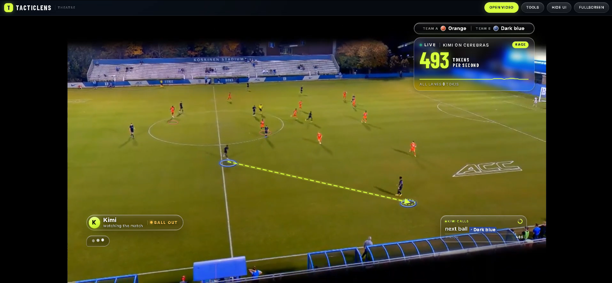

# TacticLens

A live tactical overlay for football video. A Chrome (MV3) extension tracks the players and the ball, works out possession, formations and pass options, and draws them over the match together with short analyst cards. Detection runs locally in the browser (YOLO models through onnxruntime-web on WebGPU); the commentary is written by Kimi through the Cerebras API. Built for a Cerebras x Kimi hackathon.

## Screenshots




## How it works

```
video frame -> brain (YOLO ONNX, tracking, teams, scene) -> core engine (possession, events)
            -> director / LLM lanes (Kimi on Cerebras) -> overlay
```

- The brain page samples the video, runs the person and ball detectors on WebGPU, then tracks, assigns teams and classifies the shot type.
- `core/` turns tracks into possession, passes, pressing, overloads and formation changes. It is plain TypeScript with no DOM and runs the same in the browser and in Node.
- The director lanes send Kimi a compact match state; Kimi chooses the callouts and graphics and writes the short commentary lines, and the overlay draws them.
- Requests carry that tracking summary, not video. A pause-and-ask question (and an opt-in vision lane) also sends an annotated frame to the provider.

## Prerequisites

- Node 22 or newer (the commands below were run on Node 24) and pnpm
- Python 3 with `venv`, for the one-off model export (it installs PyTorch through ultralytics, so expect a large download)
- Chrome with WebGPU
- For live commentary only: a Cerebras API key and the Kimi model id for your hackathon account

No test clip ships with the repo. Use any football match video you have the rights to.

## Reproduce

1. Clone the repo and install dependencies: `pnpm i`
2. Run the checks (no key or models needed): `pnpm test`, `pnpm typecheck`, `pnpm lint`
3. Replay a synthetic session through the engine (no key or models needed):

   ```sh
   pnpm replay fixtures/synth-balanced.jsonl
   ```

   ```
   source synthetic | mode frames | 500 frames | 99.8 s | engine 1.577 ms/frame
   possession   A 56.6%  B 43.4%   (credited A 44.8 s, B 34.4 s)
   formation    A 4-4-2  B 4-4-2   | gate toggles 124
   events (54)
        2.4 s  pass               A     conf 0.90  {"from":5,"to":1}
        3.4 s  overload           A     conf 0.90  {"near":"10 v 2","attackers":10,"defenders":2}
   ...
   ```

   The timing figure comes from one run on a development machine and will differ on yours.
4. Export the models. This downloads the pretrained player detector and writes the three ONNX files the build needs into `models/onnx/`:

   ```sh
   python -m venv models/.venv
   source models/.venv/bin/activate      # Windows: models\.venv\Scripts\activate
   pip install -r models/requirements.txt
   python models/export_onnx.py
   ```

   The ball-detector weights are no longer hosted upstream, so supply your own YOLO11n ball `best.pt` at `models/weights/yolo11n-soccernet-ball/best.pt` first (details in `models/README.md`). Steps 1 to 3 do not need any models.

5. Create your env file with `cp .env.example .env` (`copy` on Windows) and set `CEREBRAS_KIMI_MODEL`. It is read at build time; the model id can also be typed into the extension popup. The API key is never put in `.env` for the extension (see step 7).
6. Build with `pnpm build`, then open `chrome://extensions`, enable Developer mode, choose "Load unpacked" and select `extension/.output/chrome-mv3`.
7. Add the API key and play a clip:
   - Click the TacticLens toolbar icon. In the popup keep "Kimi provider" on "Cerebras: Kimi", check the "Kimi model id" field, paste your key into "API key for selected provider" and press "Save key". The key is stored in `chrome.storage.local` and only the background worker reads it.
   - Open `chrome-extension://<extension-id>/theatre.html`; the id is shown on the extension's card at `chrome://extensions`.
   - Click "Choose a video" (or drop a file on the page) and select a match clip. The overlay and the side chat start with playback. Under "Tools" the Source selector switches between Broadcast, Game and Auto footage. Shortcuts: Space play/pause, F fullscreen, H hide controls, P perf chip.
   - Without a key, "Run the offline demo" on the landing page plays a scripted overlay; the commentary and ask features need the key.
8. Optional: `pnpm bridge` starts a local HTTP/MCP hub on `127.0.0.1:8787` that forwards match state to a Telegram analyst; see `tools/bridge/README.md` and the optional variables in `.env.example`. Turn on "Telegram live bridge" in the popup to feed it.

The toolbar's "Toggle overlay on this tab" button puts a status badge on a page's video and starts the brain there. The full overlay lives in the Theatre page, which also covers local files and DRM-protected sources the page cannot capture.

## Layout

| Path | Contents |
|------|----------|
| `core/` | Engine: tracking, team assignment, scene, possession and events, director, LLM contracts. Vitest suites. |
| `extension/` | WXT + Preact MV3 extension: content script, background worker, brain page (ONNX), Theatre page. |
| `fixtures/` | Recorded and synthetic sessions as JSONL, with ground-truth labels. |
| `models/` | Export script, requirements and notes for the ONNX models. |
| `tools/replay/` | Replay a session through the engine (`pnpm replay`, `pnpm replay:gen`). |
| `tools/bridge/` | Optional local state hub for a Telegram analyst (`pnpm bridge`, `pnpm bridge:dry`). |
| `tools/llm/`, `tools/director-live.ts` | Kimi calibration and soak scripts (`pnpm llm:calibrate`, `pnpm llm:soak`) and a live director smoke test (`pnpm director:live`). They make real API calls and need `CEREBRAS_API_KEY` and `CEREBRAS_KIMI_MODEL` in `.env`. |

## Models and licences

The detectors are third-party pretrained weights, not included in this repo and downloaded by `models/export_onnx.py`. They derive from Ultralytics YOLO, so treat them as AGPL-3.0, and some source repositories state no licence. Check the terms before redistributing the weights or the built extension. Sources and notes are in `models/README.md`.
