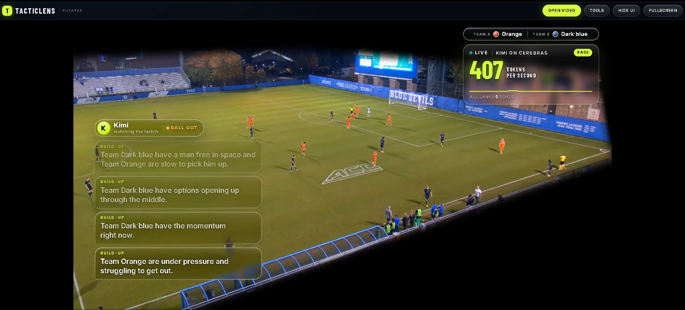

# TacticLens

A live tactical overlay for football video, with an analyst that texts you. A Chrome (MV3) extension tracks the players and the ball, works out possession, formations and pass options, and draws them over the match together with short analyst cards. Detection runs locally in the browser (YOLO models through onnxruntime-web on WebGPU); the commentary is written by Kimi through the Cerebras API. Kimi is the director: the code measures the match and hands Kimi a menu of what is true right now, and Kimi decides what goes on screen and what gets said. While you watch, TacticLens also pings you on Telegram with the live read, and an OpenClaw analyst agent (Kimi on Cerebras) answers your questions there. Built for the Cerebras x Kimi x OpenClaw 2026 hackathon.

## Screenshots




## Kimi directs, the code measures

The project is split on purpose: the code collects data, Kimi makes the editorial decisions.

| The code (deterministic, in `core/` and the brain page) | Kimi (on Cerebras) |
|---|---|
| Detects and tracks players and the ball, assigns teams, classifies the shot, computes possession, events and match statistics behind confidence gates. | Decides which graphic goes on screen, on whom, when and for how long: every decision is `show`, `hide`, `keep` or `none`, with a short caption and an optional line. |
| Turns those measurements into rule facts (an overload, a press trap, a free man, a passing lane, a switch of play) and builds the **menu**: only the graphics whose facts are valid right now. | Chooses from that menu only, and may quote only numbers that are in the data it was given. It never invents a graphic, a player or a fact. |
| Validates every decision: anything not on the menu, stale, repeated, or during a replay or close-up is rejected. The renderer admits one graphic at a time. | Writes the live commentary (a sentence plus follow-ups) and answers viewer questions about the match, on screen and on Telegram. |

Kimi never touches video or draws anything itself: it turns things on and off by choosing from what the code offers. Two things are rule-driven, not Kimi's: the stat cards (computed and shown by `core/`, rotating behind the confidence gates) and the next-pass call in the HUD (the rules pick the best passing option and resolve it from the engine's pass events). A rules safety net (`core/src/director/fallback.ts`) also puts one valid graphic from the same menu on screen when Kimi has left it empty for about 8 seconds; it never bypasses the menu or invents a fact.

## How it works

```
video frame -> brain (YOLO ONNX, tracking, teams, scene) -> core engine (possession, events)
            -> director / LLM lanes (Kimi on Cerebras) -> overlay
                                  |
                                  +-> local bridge (127.0.0.1:8787) -> Telegram pings
                                                                    <-> OpenClaw analyst (MCP tools)
```

- The brain page samples the video, runs the person and ball detectors on WebGPU, then tracks, assigns teams and classifies the shot type.
- `core/` turns tracks into possession, passes, pressing, overloads and formation changes. It is plain TypeScript with no DOM and runs the same in the browser and in Node.
- The director lanes send Kimi a compact match state; Kimi chooses the callouts and graphics and writes the short commentary lines, and the overlay draws them.
- Requests carry that tracking summary, not video. A pause-and-ask question (and an opt-in vision lane) also sends an annotated frame to the provider.

## Telegram pings and the OpenClaw analyst

TacticLens does not stop at the screen. A small local bridge (`tools/bridge`, loopback only) carries the match to your phone:

- **Live pings.** After about 10 seconds of live play the bridge texts you the latest line from the Theatre side chat on Telegram, then keeps going on that cadence. Pings pause during replays, close-ups, pauses, half-time and long ball-absence, because only the extension knows when play is live. By default a ping forwards the line already on screen, so it costs no extra model call.
- **Ask from Telegram.** Reply with a question and an OpenClaw agent on Kimi via Cerebras answers in a few sentences. It reads the live match through six MCP tools served by the bridge (`get_live_state`, `get_events_since`, `get_match_memory`, `get_latest_snapshot`, `request_graphic`, `record_update`), including the latest annotated snapshot of the video and overlay.
- **Telegram can draw on the screen.** The agent can request a graphic with `request_graphic`; it only appears in the Theatre after the same validator and calm gate as the on-screen director.
- **Let OpenClaw write the pings.** `BRIDGE_PING_MODE=agent` makes OpenClaw write every proactive update instead of mirroring the screen.

To try it: put `BRIDGE_TOKEN`, `TELEGRAM_BOT_TOKEN` and `TELEGRAM_CHAT_ID` in `.env`, rebuild the extension, run `pnpm bridge`, then tick "Telegram live bridge" in the toolbar popup (or open the Theatre with `?bridge=1`) and play a clip. The OpenClaw side is in `openclaw/`: `openclaw/README.md` is the full setup guide (install, Telegram pairing, env, MCP registration, webhook, troubleshooting), `openclaw/openclaw.json5` is the config template to merge into `~/.openclaw/openclaw.json`, and `openclaw/skills/tacticlens-analyst/SKILL.md` is the analyst skill that tells the agent how to write updates and answer questions. `pnpm bridge:dry` replays a recorded session through the analyst prompt on Cerebras without Telegram or OpenClaw, to check the wiring (needs `CEREBRAS_API_KEY` and `CEREBRAS_KIMI_MODEL`).

The bridge exposes only the match state and the snapshot you choose to send: enable it only when you are comfortable sending that frame to your model and your Telegram chat.

## Prerequisites

- Node 22 or newer (the commands below were run on Node 24) and pnpm
- Python 3 with `venv`, for the one-off model export (it installs PyTorch through ultralytics, so expect a large download)
- Chrome with WebGPU
- For live commentary only: a Cerebras API key and the Kimi model id for your hackathon account

No test clip ships with the repo. Use any football match video you have the rights to.

## Reproduce

1. Clone the repo and install dependencies: `pnpm i`
2. Run the checks (no key or models needed): `pnpm test`, `pnpm typecheck`, `pnpm lint`
3. Replay a synthetic session through the engine (no key or models needed):

   ```sh
   pnpm replay fixtures/synth-balanced.jsonl
   ```

   ```
   source synthetic | mode frames | 500 frames | 99.8 s | engine 1.577 ms/frame
   possession   A 56.6%  B 43.4%   (credited A 44.8 s, B 34.4 s)
   formation    A 4-4-2  B 4-4-2   | gate toggles 124
   events (54)
        2.4 s  pass               A     conf 0.90  {"from":5,"to":1}
        3.4 s  overload           A     conf 0.90  {"near":"10 v 2","attackers":10,"defenders":2}
   ...
   ```

   The timing figure comes from one run on a development machine and will differ on yours.
4. Export the models. This downloads the pretrained player detector and writes the three ONNX files the build needs into `models/onnx/`:

   ```sh
   python -m venv models/.venv
   source models/.venv/bin/activate      # Windows: models\.venv\Scripts\activate
   pip install -r models/requirements.txt
   python models/export_onnx.py
   ```

   The ball-detector weights are no longer hosted upstream, so supply your own YOLO11n ball `best.pt` at `models/weights/yolo11n-soccernet-ball/best.pt` first (details in `models/README.md`). Steps 1 to 3 do not need any models.

5. Create your env file with `cp .env.example .env` (`copy` on Windows) and set `CEREBRAS_KIMI_MODEL`. It is read at build time; the model id can also be typed into the extension popup. The API key is never put in `.env` for the extension (see step 7).
6. Build with `pnpm build`, then open `chrome://extensions`, enable Developer mode, choose "Load unpacked" and select `extension/.output/chrome-mv3`.
7. Add the API key and play a clip:
   - Click the TacticLens toolbar icon. In the popup keep "Kimi provider" on "Cerebras: Kimi", check the "Kimi model id" field, paste your key into "API key for selected provider" and press "Save key". The key is stored in `chrome.storage.local` and only the background worker reads it.
   - Open `chrome-extension://<extension-id>/theatre.html`; the id is shown on the extension's card at `chrome://extensions`.
   - Click "Choose a video" (or drop a file on the page) and select a match clip. The overlay and the side chat start with playback. Under "Tools" the Source selector switches between Broadcast, Game and Auto footage. Shortcuts: Space play/pause, F fullscreen, H hide controls, P perf chip.
   - Without a key, "Run the offline demo" on the landing page plays a scripted overlay; the commentary and ask features need the key.
8. Optional, Telegram and OpenClaw: set the bridge variables from `.env.example`, rebuild, run `pnpm bridge` and turn on "Telegram live bridge" in the popup (see "Telegram pings and the OpenClaw analyst" above and `tools/bridge/README.md`).

The toolbar's "Toggle overlay on this tab" button puts a status badge on a page's video and starts the brain there. The full overlay lives in the Theatre page, which also covers local files and DRM-protected sources the page cannot capture.

## Layout

| Path | Contents |
|------|----------|
| `core/` | Engine: tracking, team assignment, scene, possession and events, director, LLM contracts. Vitest suites. |
| `extension/` | WXT + Preact MV3 extension: content script, background worker, brain page (ONNX), Theatre page. |
| `fixtures/` | Recorded and synthetic sessions as JSONL, with ground-truth labels. |
| `models/` | Export script, requirements and notes for the ONNX models. |
| `tools/replay/` | Replay a session through the engine (`pnpm replay`, `pnpm replay:gen`). |
| `tools/bridge/` | Local hub that pings Telegram and serves the match to the OpenClaw analyst over MCP (`pnpm bridge`, `pnpm bridge:dry`). |
| `openclaw/` | OpenClaw setup guide, config template and the `tacticlens-analyst` skill. |
| `tools/llm/`, `tools/director-live.ts` | Kimi calibration and soak scripts (`pnpm llm:calibrate`, `pnpm llm:soak`) and a live director smoke test (`pnpm director:live`). They make real API calls and need `CEREBRAS_API_KEY` and `CEREBRAS_KIMI_MODEL` in `.env`. |

## Models and licences

The detectors are third-party pretrained weights, not included in this repo and downloaded by `models/export_onnx.py`. They derive from Ultralytics YOLO, so treat them as AGPL-3.0, and some source repositories state no licence. Check the terms before redistributing the weights or the built extension. Sources and notes are in `models/README.md`.
